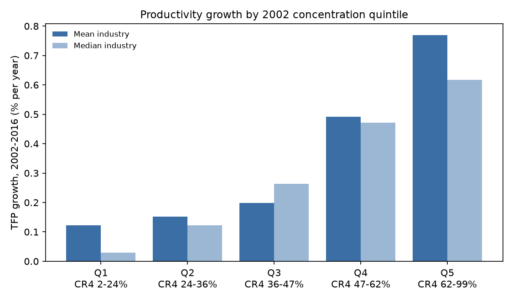
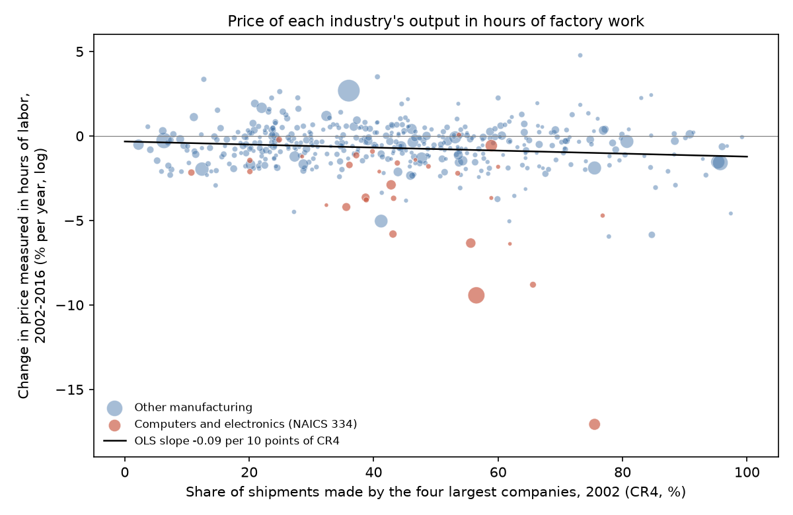
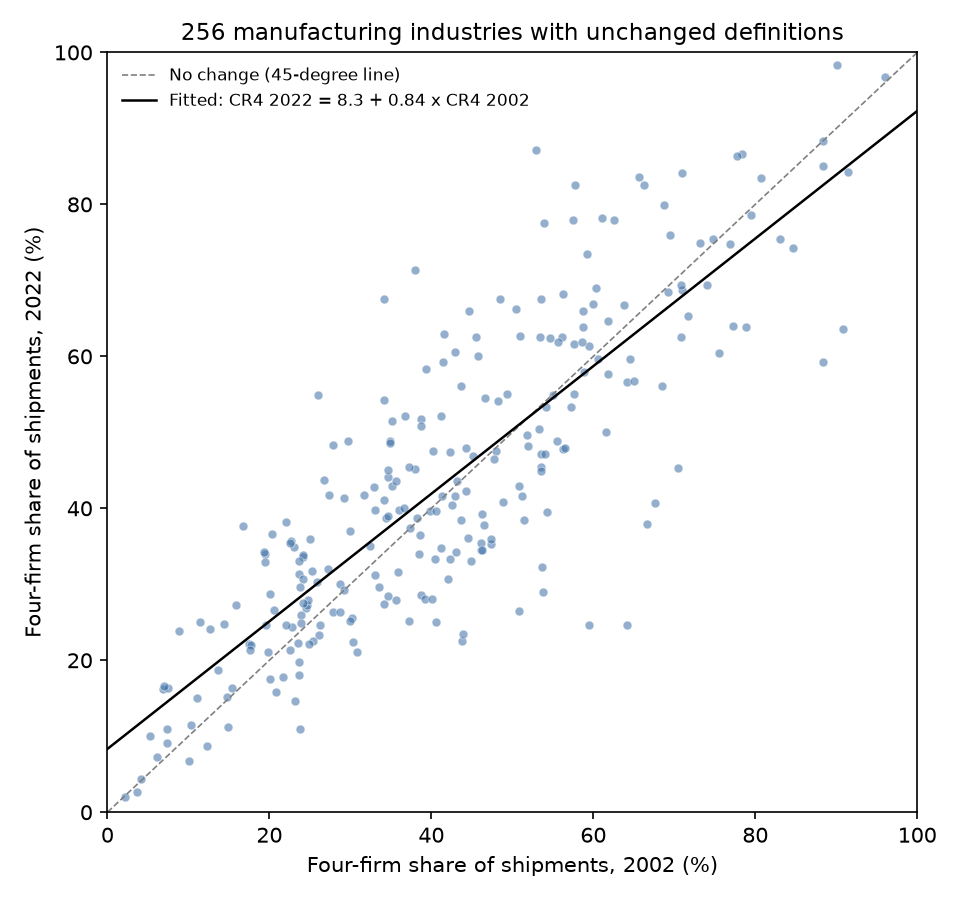

# The Perennial Gale

### In 1942, Joseph Schumpeter argued that big companies with market power, not crowds of small competitors, are what make things cheaper over time. I asked the same question of 471 American manufacturing industries.

---

In 2002 the four largest American computer makers, a group led by Dell, Hewlett-Packard and Apple, shipped 75.5%
of the computers built in the United States. Fourteen years later the industry's output cost 91% fewer hours of
factory work to buy than it had in 2002. Semiconductor makers such as Intel, Texas Instruments and Micron, where the
top four held 56.5% of the market, cut the same price by 73%. Ready-mix concrete, made by 2,614 companies of which the
four largest shipped 11.1%, went the other way, and its output cost 17% more hours of work in 2016 than in 2002.

The textbook view holds that a market with many small sellers serves its customers best, because no one of them
can hold prices up. Joseph Schumpeter thought
that view had the matter backwards. The goods that had grown cheapest in his lifetime, he said, came from industries
run by a few large firms, and the profits that came with their market power were the reward that paid for the
next round of invention.

---

## Three measures

The first measure is how much of an industry its largest companies control. The Census Bureau's Economic Census
reports, for each of roughly 470 manufacturing industries, the share of shipments made by the four largest
companies. Writing $`s_{1j}, \dots, s_{4j}`$ for the four largest market shares in industry $`j`$,

```math
\text{CR4}_j = s_{1j} + s_{2j} + s_{3j} + s_{4j}
```

Breakfast cereal had 45 companies in 2002, and the four largest, Kellogg, General Mills, Post and Quaker, shipped
78.4% of it. Machine shops, the small firms that cut parts to order, had 22,180 companies, and the four largest
shipped 2.2%.

| Market | Calculation | CR4 |
|---|---|---|
| One company with everything | 100 | 100% |
| Four equal companies and nobody else | 25 + 25 + 25 + 25 | 100% |
| A hundred equal companies | 1 + 1 + 1 + 1 | 4% |

The second measure is the one Schumpeter himself proposed. He suggested following the prices of everyday goods
"not in terms of money but in terms of the hours of labor that will buy them," which he defined as each year's
money price divided by each year's hourly wage. For industry $`j`$ in year $`t`$, with $`p_{jt}`$ the price index
of the industry's shipments and $`\bar{w}_t`$ the average hourly pay of a production worker across all of
manufacturing, the price in hours of labor and its annual rate of change over $`T`$ years are

```math
H_{jt} = \frac{p_{jt}}{\bar{w}_t}, \qquad g^{H}_j = \frac{100}{T}\,\ln\frac{H_{j,2016}}{H_{j,2002}}
```

A production worker in American manufacturing earned $16.37 an hour in 2002 and $23.28 in 2016. Over the same years
the price index for semiconductors fell from 0.208 to 0.079.

```math
\frac{H_{2016}}{H_{2002}} = \frac{0.079 / 23.28}{0.208 / 16.37} = 0.267,
\qquad g^{H} = \frac{100}{14}\ln 0.267 = -9.43\%\ \text{a year}
```

So the chips a worker could buy with one hour of pay in 2002 took about a quarter of an hour in 2016.

The third measure is productivity. Total factor productivity, or TFP, is the output an industry gets from all of
its inputs together, so that its growth is whatever part of output growth more labor, machines, materials and
energy cannot explain. With $`Q_j`$ real output, $`X_{ij}`$ the five inputs and $`\bar{s}_{ij}`$ each input's
average share of cost,

```math
\Delta \ln A_j = \Delta \ln Q_j - \sum_{i=1}^{5} \bar{s}_{ij}\, \Delta \ln X_{ij}
```

The NBER-CES database reports the semiconductor industry's TFP index at 2.729 in 2002 and 5.430 in 2016, so
$`100 \times \ln(5.430/2.729)/14 = 4.91\%`$ a year. The industry roughly doubled the output it got from each
bundle of inputs.

---

## Joseph Schumpeter's argument

Joseph Alois Schumpeter was born in 1883 in Triesch, a town in the Moravian part of the Habsburg empire. He was
briefly Austria's finance minister in 1919, was president of the Biedermann Bank from 1921 until 1924, and held a
chair at the University of Bonn from 1925 until 1932, when he moved to Harvard. He served as president of the American
Economic Association in 1948 and died at his home in Taconic, Connecticut, in January 1950.

The book asks whether capitalism can survive, and Schumpeter's answer was that it probably would not, because its
own success would breed hostility to it. The two chapters economists still argue over, the seventh and eighth,
make a narrower claim. Schumpeter called capitalism a process of "creative destruction" in which new goods, new
methods and new forms of organization keep replacing old ones, and he argued that this process, not price
competition among many small sellers, is the competition that matters. A firm with market power is always under
attack from the next product, so its position is "no cushion to sleep on." He concluded that the large-scale firm
had become "the most powerful engine of that progress," and that perfect competition was not only impossible but
inferior.

His evidence was a footnote and a challenge. The footnote concerned the Aluminum Company of America, which most
economists of his day called a monopoly. From 1890 to 1929, he wrote, the price of its basic product fell to about
12% of its starting level, or about 8.8% after correcting for the general price level, while output rose from 30
metric tons to 103,400. The challenge was to list the items in a worker's budget whose prices had fallen fastest in
hours of labor, and to see that the trail led "to the doors of the large concerns."

The logic behind his yardstick takes a few lines of algebra. Suppose an industry produces with constant returns to
scale and productivity scales up the output of all inputs alike, so that the cost of one unit is $`c(\mathbf{w})/A`$, where $`\mathbf{w}`$ lists the prices of its inputs
and $`A`$ is its productivity, and suppose it charges a markup $`\mu`$ over that cost. Write $`s_i`$ for input
$`i`$'s share of cost, which by Shephard's lemma is the elasticity of unit cost with respect to that input's price,
and $`\Delta`$ for a small change over time, so that the third line holds to a first-order approximation. Then

```math
\begin{aligned}
p &= \mu \cdot \frac{c(\mathbf{w})}{A} \\
\ln \frac{p}{\bar{w}} &= \ln \mu + \ln c(\mathbf{w}) - \ln \bar{w} - \ln A \\
\Delta \ln \frac{p}{\bar{w}} &= \Delta \ln \mu + \sum_i s_i\, \Delta \ln w_i - \Delta \ln \bar{w} - \Delta \ln A \\
&= \Delta \ln \mu + \sum_i s_i \left( \Delta \ln w_i - \Delta \ln \bar{w} \right) - \Delta \ln A
\end{aligned}
```

The last line uses the fact that cost shares add up to one. In words, an industry's goods get cheaper in hours of
work when its productivity rises faster than its markup does, once its own input prices are allowed for.
Schumpeter's claim is that in industries run by a few large firms, the productivity term outruns the markup term.

The best-known objection came from Kenneth Arrow in 1962, who showed that a monopolist gains less from a cost-cutting
invention than a competitive industry does, because it already earns a profit on the old method. On the empirical
side, F. M. Scherer's 1965 study in the *American Economic Review* found that patents rise with firm size but more
slowly than sales do, and that once an industry's technological opportunity is accounted for, market power explains
little. Stephen Nickell's 1996 study of about 670 British companies in the *Journal of Political Economy* found that
more competition went with faster productivity growth, not slower. Scherer's point is the hardest one for any test
like mine, since an industry built on fast-moving science may be concentrated and fast-improving for the same
underlying reason. The question still matters because antitrust agencies weighing a merger are often told that a
bigger combined firm will invest and innovate more, which is Schumpeter's argument in modern form.

---

## How I tested it

Schumpeter's book has no regressions, so the test is his own comparison done systematically. I took every six-digit
manufacturing industry in the 2002 Economic Census, 473 of them, and matched each to the NBER-CES Manufacturing
Industry Database, which the National Bureau of Economic Research and the Census Bureau's Center for Economic
Studies publish for the same industries through 2018, and every industry matched. Two have their concentration figures
withheld by the Census to protect company confidentiality, which leaves 471. I measured concentration in 2002 and
followed each industry to 2016, the last year for which the database reports productivity. Fourteen years is
shorter than the decades Schumpeter had in mind when he wrote that one must "judge its performance over time," but
it is as long as the productivity data allow.

For each industry I computed four outcomes from 2002 to 2016, namely the annual change in its price in hours of
labor, in its real output, in its TFP, and the change in its price-cost margin, defined as value added minus payroll
as a share of shipments. Then I regressed each outcome on 2002 concentration.

```math
y_j = \alpha + \beta\,\frac{\text{CR4}_{j,2002}}{10} + \gamma_{s(j)} + \varepsilon_j,
\qquad H_0\!: \beta = 0
```

Here $`y_j`$ is one of the four outcomes for industry $`j`$, $`\beta`$ is the change in that outcome for every 10
points of concentration, and $`\gamma_{s(j)}`$ is a fixed effect for the three-digit subsector the industry belongs
to, included in one version and dropped in the others.
Schumpeter predicts $`\beta > 0`$ for TFP and output and $`\beta < 0`$ for the price in hours. Standard errors are
clustered by the 86 four-digit industry groups, because closely related industries share shocks. I also ran the
regression weighted by 2002 value added, without the computer and electronics subsector, as a median regression
that ignores outliers, with CR8 and the Herfindahl index in place of CR4, with the logarithm of average company size
in place of concentration, and on a second window from 2007 to 2016.

---

## Concentrated industries raised productivity faster

Sorting the 471 industries into fifths by their 2002 concentration gives a clear gradient.

| Four largest companies' share, 2002 | Industries | TFP growth, % a year | Price in hours of labor, % a year | Real output, % a year |
|---|---|---|---|---|
| 2.2% to 23.8% | 97 | 0.12 | -0.55 | -0.66 |
| 23.9% to 36.0% | 92 | 0.15 | -0.44 | -1.51 |
| 36.1% to 47.3% | 95 | 0.20 | -0.66 | -0.71 |
| 47.4% to 61.8% | 93 | 0.49 | -0.90 | -0.97 |
| 61.9% to 99.2% | 94 | 0.77 | -1.01 | -1.27 |

The most concentrated fifth improved its productivity by 0.65 percentage points a year more than the least
concentrated fifth, which compounds to about 9.5% more output from the same inputs by 2016. The regression slope,
with standard errors clustered by industry group, is

```math
\hat{\beta}_{A} = 0.121\ (0.054), \quad 95\%\ \text{CI}\ [0.015,\ 0.226], \quad N = 471
```

Each 10 points of concentration went with 0.12 points a year of extra productivity growth. The median regression, which limits the pull of extreme industries, gives 0.101 (p = 0.002). CR8
gives 0.116, the 2007 to 2016 window gives 0.140, and value-added weighting gives 0.169 (p = 0.051).

One check matters more than the rest. The NBER-CES price indexes for petroleum refining and basic petrochemicals
fall far faster in 2015 and 2016 than the prices of the oil and feedstocks those industries buy, which inflates
their measured output and productivity. Petrochemicals, with a CR4 of 84.7%, shows an implausible 7.67% a year of TFP
growth. Leaving out the two industries
lowers the slope to 0.107 (p = 0.055), so the headline estimate leans partly on two suspect data points.



Two more checks weaken it, and both point toward Scherer's objection. Dropping the computer and electronics subsector,
where Moore's law has driven productivity for decades, lowers the slope to 0.086 (p = 0.08). Comparing industries
only with others in the same subsector lowers it to 0.093 (p = 0.15). So the
concentrated industries are partly the ones with the most technology to exploit. Within subsectors the
estimate keeps its sign and most of its size but loses its precision.

---

## Cheaper goods came mainly from computers and chips

Productivity is Schumpeter's mechanism, but his yardstick was the price a worker pays. On that measure the
concentrated industries also did better on average. Industries where the top four held at least half the market
cut their price in hours of labor by 0.98% a year, against 0.56% for the rest (Welch t = -2.29, p = 0.023).
Weighted by size, the gap is wider, -2.05% against -0.48%.

```math
\hat{\beta}_{H} = -0.090\ (0.052), \quad 95\%\ \text{CI}\ [-0.192,\ 0.013], \quad N = 471
```

That average rests on a small number of industries. The median regression gives a slope of 0.000, and without the
computer and electronics subsector the slope falls to -0.044 (p = 0.24). For the typical concentrated industry,
goods did not get cheaper in hours of work any faster than in the typical competitive one. The Census does not name
companies, so the leaders listed below are each industry's best-known producers in 2002.

| Industry | Leading companies in 2002 | Top 4's share, 2002 | Price in hours of labor, 2002 to 2016 | TFP, 2002 to 2016 |
|---|---|---|---|---|
| Cigarettes | Philip Morris (Altria), R.J. Reynolds | 95.3% | -19% | +9% |
| Primary aluminum | Alcoa, Century Aluminum | 85.3% | -35% | +49% |
| Aircraft | Boeing | 80.7% | -4% | +15% |
| Breakfast cereal | Kellogg, General Mills, Post, Quaker | 78.4% | -6% | -28% |
| Computers | Dell, Hewlett-Packard, Apple | 75.5% | -91% | +276% |
| Automobiles | General Motors, Ford, DaimlerChrysler, Toyota | 75.5% | -23% | -3% |
| Semiconductors | Intel, Texas Instruments, Micron | 56.5% | -73% | +99% |
| Pharmaceuticals | Pfizer, Merck, Johnson & Johnson | 36.0% | +46% | -44% |
| Sawmills | Weyerhaeuser among 3,462 companies | 17.5% | -24% | +38% |
| Commercial printing | 14,970 companies | 12.4% | -24% | +12% |
| Ready-mix concrete | 2,614 companies | 11.1% | +17% | -10% |
| Machine shops | 22,180 companies | 2.2% | -7% | -4% |

Alcoa's industry still fits Schumpeter's footnote on productivity and price. Its TFP rose by about half and its price
in hours of work fell by about a third, though unlike Alcoa's output in Schumpeter's day, its real output shrank
by 30%. Computers and semiconductors fit him best of all. But breakfast cereal, where four companies shipped 78.4% of
the output, lost productivity, and so did the auto industry. Sawmills and print shops, run by thousands
of small firms, made their goods cheaper in hours of work at about the pace of the car makers.



The productivity gains of concentrated industries did not obviously turn into wider margins either. The change in
the price-cost margin is unrelated to 2002 concentration in the unweighted regression (-0.06 points per 10 points
of CR4, p = 0.79). Weighted by value added the slope is negative (-0.65, p = 0.009), pulled down by large
concentrated industries whose margins narrowed, among them semiconductors (21.6 points), automobiles (10.3) and
cigarettes (6.0). Real output grew no faster in concentrated industries (-0.05, p = 0.71). Average company
size, the variable closest to Schumpeter's own emphasis on the large concern, predicts faster output growth across
all industries (0.59 points a year per log point, p < 0.001) but not within subsectors.

---

## Concentration lasts for decades

Schumpeter's case for tolerating market power rested on its being temporary. If the gale really wears positions
down, the concentrated industries of 2002 should look much less concentrated twenty years later. I kept the 256
industries whose six-digit definition did not change in any of the four NAICS revisions between 2002 and 2022,
using the Census Bureau's official concordances, and regressed concentration in 2022 on concentration in 2002, with standard errors clustered by four-digit group.

```math
\text{CR4}_{j,2022} = a + \rho\, \text{CR4}_{j,2002} + u_j, \qquad H_0\!: \rho = 1
```

A value of $`\rho = 1`$ would mean concentration never fades, and $`\rho = 0`$ would mean the 2002 figure says
nothing about 2022. Treating the twenty years as repeated steps of the same process, the share of any departure from
the long-run average that is left after one year is $`\rho^{1/20}`$, and the half-life of a departure is
$`h = 20 \ln 0.5 / \ln \hat{\rho}`$.

```math
\hat{\rho} = 0.840\ (0.035), \quad 95\%\ \text{CI}\ [0.770,\ 0.909], \quad
\hat{\rho}^{1/20} = 0.991, \quad h = 79\ \text{years}\ [53,\ 145], \quad N = 256
```

The bracket gives the half-life at each end of the interval for $`\hat{\rho}`$. Persistence is significantly below one (t = -4.53), but a slope below one means industries drift toward a common
level, which the fitted line puts at 52.0%, so it pulls unconcentrated industries up as well as concentrated ones
down. Industries that began at or above 50% lost 2.0 points on average, and those below gained 3.5. Of the 88 industries
where the top four held at least half the market in 2002, 67 still did in 2022, and 21 industries crossed the line
in the other direction. Average CR4 in this sample rose from 42.0% to 43.6%.

| 2002 share of the top four | Under 25% in 2022 | 25 to 50% | 50 to 75% | 75% or more |
|---|---|---|---|---|
| Under 25% | 39 | 24 | 0 | 0 |
| 25 to 50% | 7 | 77 | 21 | 0 |
| 50 to 75% | 2 | 19 | 38 | 12 |
| 75% or more | 0 | 0 | 7 | 10 |

The clearest case of the gale is beer. In 2002 the top four brewers, led by Anheuser-Busch, Miller and Coors,
shipped 90.8% of American beer from an industry of 349 companies. By 2022 the industry had 4,857 companies and the
top four's share was down to 63.6%. Computers fell from 75.5% to 60.5% and
semiconductors from 56.5% to 48.0%. Aircraft went from 80.7% to 83.5%, breakfast cereal from 78.4% to 86.6%, and
petroleum refining from 41.2% to 52.2%.



---

## Why it matters

For consumers, the data gives Schumpeter part of what he claimed. The industries run by a few firms did raise
productivity faster from 2002 to 2016, and on average their goods got cheaper in hours of work. That average is
carried by electronics, though, and the typical concentrated industry delivered no faster price declines than the
typical competitive one.

For workers, wages are the other half of Schumpeter's measure. A production worker's hourly pay rose from $16.37
to $23.28, and across manufacturing, weighted by size, prices measured in hours of that work fell by 1.05% a year.

For smaller firms, the persistence results matter more than the productivity ones. Only 35% of industries saw the
top four's share move by 10 points or more in twenty years, and beer, where thousands of small companies entered,
is the exception rather than the rule.

For policy, the data does not support either extreme. It does not show that concentration stops progress, which
is the worry behind proposals to break up large firms. It also does not support Schumpeter's case for leaving
dominance alone because it will soon be swept away, since with a half-life of at least fifty years it is not swept away
on any timescale that matters to a merger review.

---

## Limits of this study

The Census measures concentration among plants located in the United States and ignores imports, which matter a
great deal for computers, semiconductors and autos. Six-digit industries are not markets, and a national share
overstates competition in local goods such as concrete and understates it in niche ones. The NBER-CES price indexes
for computers and chips adjust for quality, which is correct but makes those industries' gains depend on how
quality is valued. Productivity is measured as a residual and absorbs any error in the inputs, and the price-cost
margin is an accounting proxy for the markup, not the markup itself. The regressions show which kinds of industries
improved, not that concentration caused the improvement, and Scherer's technological opportunity is the most
likely common cause. The persistence test counts how concentrated an industry stayed, not whether the same companies
stayed on top, so it can miss a gale that replaces one set of leaders with another, and year-to-year noise in measured CR4
pulls $`\hat{\rho}`$ toward zero, which makes the half-life, if anything, too short. The NBER-CES price indexes
for refining and petrochemicals break in 2015 and 2016, and the productivity result is weaker without those two
industries.

---

## Further reading

- [TECHNICAL.md](TECHNICAL.md) has the data, rules, every test statistic and how to reproduce the results.
- [results/FINDINGS.md](results/FINDINGS.md) has a plain-English summary and every table the scripts produce.
- [METHODS_REVIEW.md](METHODS_REVIEW.md) reviews the methods and evidence of the original book.
- Joseph A. Schumpeter, *Capitalism, Socialism and Democracy* (New York, Harper & Brothers, 1942), especially
  chapter 7, "The Process of Creative Destruction," and chapter 8, "Monopolistic Practices."
- US Census Bureau, 2002, 2007 and 2022 Economic Census concentration tables (`EC0231SR12`, `EC0731SR12`,
  `EC2200SIZECONCEN`), and the NAICS concordances for 2002 to 2022.
- Randy A. Becker, Wayne B. Gray and Jordan Marvakov, NBER-CES Manufacturing Industry Database (1958 to 2018,
  version 2021a), National Bureau of Economic Research, 2021.
- F. M. Scherer, "Firm Size, Market Structure, Opportunity, and the Output of Patented Inventions," *American
  Economic Review* 55(5), 1965. Stephen J. Nickell, "Competition and Corporate Performance," *Journal of Political
  Economy* 104(4), 1996. Kenneth J. Arrow, "Economic Welfare and the Allocation of Resources for Invention," 1962.

*Brendyn Beasley*
